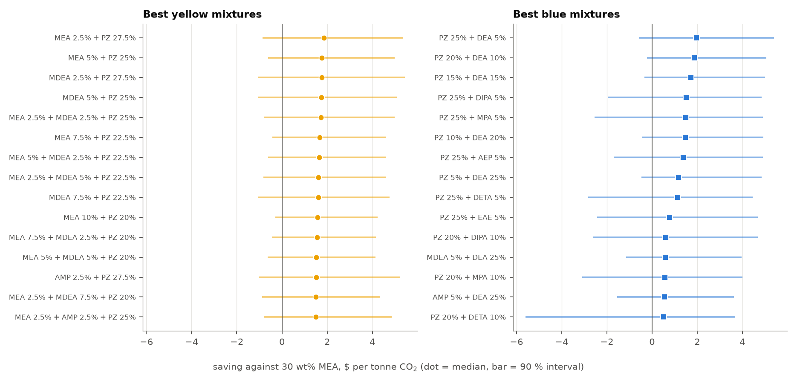

# amine-co2-uq

**Uncertainty-aware screening of amine mixtures for post-combustion CO₂ capture**

[](LICENSE)
[](environment.yml)
[](CITATION.cff)

Which amine blends are worth testing in the lab for capturing CO₂ from cement and coal flue gas?
This repository answers that with a calibrated equilibrium model, explicit uncertainty, and a
running-cost comparison against the industry benchmark, 30 wt% monoethanolamine (MEA).
One command rebuilds every list, table and figure from the tracked data.

---

## Contents

- [Highlights](#highlights)
- [Quick start](#quick-start)
- [What the pipeline does](#what-the-pipeline-does)
- [Outputs](#outputs)
- [Results](#results)
- [Validation](#validation)
- [Limitations](#limitations)
- [Reproducibility](#reproducibility)
- [Repository layout](#repository-layout)
- [Optional: Neo4j graph](#optional-neo4j-graph)
- [Data and provenance](#data-and-provenance)
- [Citation](#citation)
- [Acknowledgements](#acknowledgements)
- [License](#license)

---

## Highlights

- **About 23,000 mixtures** at 30 wt% total amine, screened for two scenarios: cement (20 kPa CO₂)
  and coal (13 kPa CO₂) flue gas.
- **Calibrated chemistry.** The equilibrium model is fitted to measured CO₂ loading and heat data for
  MEA, MDEA, PZ, AMP, DETA, DEA and MPA, then checked on data sets it never saw.
- **Uncertainty throughout.** Monte Carlo sampling over model parameters and cost inputs, plus a
  conformal margin for blend error, gives every result an interval and a probability of beating MEA.
- **One cost scale.** Regeneration energy, solvent make-up, corrosion, viscosity and first fill are
  combined into a single running cost in USD per tonne of CO₂.
- **Lab-ready output.** Three ranked lists: a combined top 100, and separate top-50 lists for the two
  mixture families below.

| Family | Definition |
|---|---|
| **Yellow** | Mixtures of the four benchmark amines only: MEA, MDEA, PZ (piperazine), AMP |
| **Blue** | At least one benchmark amine plus at least one other amine |

## Quick start

Requires [conda](https://conda-forge.org/download/) (Miniforge recommended) and git.

```bash
git clone https://github.com/frozenexplorer/uq-amine.git
cd uq-amine
conda env create -f environment.yml
conda activate amine-co2-uq
python run_all.py
```

A full run takes about 5–10 minutes on a laptop. It finishes with `All steps completed.`, and the lab
lists are then in [`reports/results/`](reports/results/).

<details>
<summary>Using pip instead of conda</summary>

```bash
python -m venv .venv
.venv\Scripts\activate            # Windows
source .venv/bin/activate         # macOS / Linux
pip install -r requirements.txt
python run_all.py
```

Use Python 3.11. Conda is the tested route.
</details>

To run the sanity tests on their own: `python -m tests.test_practical` (pytest also collects them).

## What the pipeline does

```
measured VLE, heat and viscosity data ─► calibrate equilibrium model (+ conformal margin)
                                                          │
partner amines (curated + screening library) ─────────────┤
                                                          ▼
          screen ≈23k mixtures × 48 Monte Carlo samples × 2 scenarios
                                                          │
prices, degradation, corrosion, viscosity, vendors ───────┤
                                                          ▼
          practical stage: $ / t CO₂, practical filter, ranks
                                                          │
                       ┌──────────────────────────────────┼──────────────────┐
                 figures                            lab lists          Neo4j graph
```

`run_all.py` runs these steps in order:

| # | Step | Module |
|---|---|---|
| 1 | RDKit smoke test | `src/data/smoke_test.py` |
| 2 | Ingest measured data (NIST ThermoML, Xu 2011, Aronu 2011, Dugas 2009, Hilliard 2008) | `src/data/ingest_*.py` |
| 3 | Calibrate the equilibrium model | `src/thermo/calibrate.py` |
| 4 | Enumerate and screen yellow / blue mixtures | `src/screening/run_screen.py` |
| 5 | Practical stage: running cost and filter | `src/screening/practical.py` |
| 6 | Screening figures and capacity / energy shortlist | `src/viz/screening_plots.py` |
| 7 | Practical figures and the three lab lists | `src/viz/practical_lists.py` |
| 8 | Sanity tests | `tests/test_practical.py` |

**Process model.** The rich solvent is in equilibrium at the absorber bottom (40 °C, feed CO₂ partial
pressure) and the lean solvent at the stripper bottom (120 °C, 5 kPa). Cyclic capacity is the
difference per kg of solvent. Reboiler duty is a short-cut sum of desorption heat, sensible heat and
stripping steam (after Oexmann & Kather, 2010).

**Running cost** (USD per t CO₂) = energy + amine make-up + first fill + corrosion + viscosity.
Energy is scaled so that 30 wt% MEA needs 3.7 GJ/t; heat costs $6/GJ for cement and $3.4/GJ for coal.
Every input and its basis is in
[`data/processed/practical/amine_inputs.csv`](data/processed/practical/amine_inputs.csv) and `SCALARS`
in [`src/screening/practical.py`](src/screening/practical.py).

**Practical filter.** A mixture is dropped if a partner amine has a reactive group (for example an
epoxide) or fewer than five vendors on PubChem. High corrosion and PZ solidification are flagged, not
dropped.

## Outputs

| File | Contents |
|---|---|
| [`reports/results/lab_list_combined.md`](reports/results/lab_list_combined.md) (`.csv`) | Top 100 mixtures by saving against 30 wt% MEA |
| [`reports/results/lab_list_yellow.md`](reports/results/lab_list_yellow.md) (`.csv`) | Top 50 yellow mixtures |
| [`reports/results/lab_list_blue.md`](reports/results/lab_list_blue.md) (`.csv`) | Top 50 blue mixtures |
| [`reports/results/shortlist_top100.md`](reports/results/shortlist_top100.md) (`.csv`) | Top 100 on capacity and energy alone, before cost |
| [`reports/results/ranking_change_*.md`](reports/results/) | How the ranking moved after each recalibration |
| [`reports/figures/`](reports/figures/) | Calibration, screening and cost figures |
| [`data/processed/practical/checks.json`](data/processed/practical/checks.json) | Energy benchmark and sensitivity of the lists |
| [`data/processed/thermo/calibrated_core_amines.json`](data/processed/thermo/calibrated_core_amines.json) | Calibrated model parameters |

Each list row gives the composition, the saving in $/t with a 90 % interval, the probability of being
cheaper than MEA, cyclic capacity, reboiler duty, make-up rate, corrosion index, the temperature below
which fresh solvent starts to solidify, and whether the partner amine is calibrated or estimated.

## Results

All values are the mean of the cement and coal scenarios. On this basis, 30 wt% MEA costs $20.7 per tonne of CO₂.

| List | Best mixture (wt%) | Saving vs MEA, $/t [90 % interval] | P(cheaper than MEA) |
|---|---|---|---|
| Blue | PZ 25% + DEA 5% | +1.92 [−0.70, +5.34] | 0.92 |
| Yellow | MEA 2.5% + PZ 27.5% | +1.80 [−0.97, +5.31] | 0.92 |
| Reference | PZ 30% | +1.85 [−1.26, +5.70] | 0.85 |



- **PZ-rich solvents lead.** The leaders differ by less than their uncertainty, so read the top of
  each list as a group, not an exact order. The best yellow mixtures are effectively PZ alone.
- **The defensible saving is about $0.8–1.9 per tonne.** Calorimetry (Hilliard 2008) puts PZ's heat
  of absorption at 120 °C about 22 kJ/mol above the model, whose heat comes from VLE data. Published
  CESAR1 : MEA energy ratios allow at most +7.7 kJ/mol. At that limit the same mixtures still lead,
  and PZ still saves $0.81/t. A measured PZ against MEA reboiler duty would settle the question.
- **216 of the 20,475 mixtures** that pass the practical filter are cheaper than MEA. Moving any
  assumption to the end of its range keeps at least 16 of each family's top 20.
- **No mixture beats MEA at its 90 % lower bound in both scenarios.** The expected saving is real
  but not proven.
- **PZ-rich solvents need handling care.** Fresh 30 wt% PZ solidifies below about 42 °C (15 wt%
  below about 25 °C). The lists give this temperature for each mixture.
- **Measured data changed the ranking.** Direct DETA data (Chang 2013) cut 30 wt% DETA's capacity from
  2.9 to 1.55 mol/kg. The earlier leader, PZ 5% + DETA 25%, fell to #4694. See
  [`ranking_change_deta_dea_mpa.md`](reports/results/ranking_change_deta_dea_mpa.md).

## Validation

| Target | Split | Error (MAE) | Coverage of 90 % interval |
|---|---|---|---|
| CO₂ loading, MEA | fit: Wagner 2013 + Aronu 2011 (236 pts) | 0.014 mol/mol | – |
| CO₂ loading, MEA / PZ / MEA+PZ, 40–100 °C | **held out**: Dugas 2009 (50 / 43 / 12 pts) | 0.012 / 0.011 / 0.009 mol/mol alkalinity | MEA 0.92 after inter-lab inflation |
| CO₂ loading, MEA / PZ / MEA+PZ, 40–60 °C | **held out**: Hilliard 2008 (55 / 62 / 41 pts) | 0.020 / 0.012 / 0.011 mol/mol N | – |
| CO₂ loading, AMP | fit: Hartono 2020 (110 pts) | 0.028 mol/mol | – |
| CO₂ loading, PZ | fit: Ermatchkov 2006 (52 pts) | 0.008 mol/mol | – |
| CO₂ loading, MDEA | joint fit: Leontiadis 2019 + Dey 2018 + Xu 2011 (112 pts) + Arcis 2008 heats | 0.031 mol/mol; heats 1.8 kJ/mol | – |
| CO₂ loading, DETA | fit: Chang 2013 (84 pts); leave-one-concentration-out 0.02–0.06 | 0.029 mol/mol | – |
| CO₂ loading, DEA | fit: Ghalib 2016 (15 pts) + Arcis 2012 heats | 0.015 mol/mol | – |
| CO₂ loading, MPA | fit: Leontiadis 2019 (60 pts) | 0.016 mol/mol | – |
| CO₂ loading, MDEA+PZ, 100–160 °C | **leave-one-blend-out**: Xu 2011 | 0.035 / 0.014 mol/mol alkalinity | 1.00 with conformal margin |
| CO₂ loading, AMP+PZ | **held out**: Dash 2011 (158 pts) | 0.052 mol/mol | 0.30 → **0.92** with conformal margin |
| Capacity of 7 m MEA, 40 °C, 0.5 → 5 kPa | **held out**: Dugas 2009 | 0.338 vs 0.328 mol/kg measured | – |
| Reboiler duty ratio, CESAR1 : MEA | benchmark against three studies | 0.90–0.91 vs 0.79–0.94 reported | – |

## Limitations

- **Absolute reboiler duty reads about 40 % low.** The cost stage therefore scales it so that
  30 wt% MEA needs 3.7 GJ/t, and keeps the ratios between solvents.
- **No loading data above 80 °C for DETA, DEA and MPA.** The 120 °C stripper end is extrapolated for
  these amines.
- **Some partners are provisional.** DIPA, AEP and the library amines use structure-based estimates.
  Those estimates were wrong for DETA, DEA and MPA, so the lists mark such rows `partner estimated`.
- **Many prices are indicative.** Several prices, and the corrosion and viscosity cost scales, are
  assumptions with ranges.
- **Blend bias.** AMP+PZ keeps a −0.05 mol/mol bias, which the conformal margin covers. Wang (2026)
  reports DETA blend capacities about 30 % above the model, but also above Chang's pure-DETA data.
- **Not a plant design.** Absorption rate, foaming and nitrosamine formation are not costed.

## Reproducibility

- **Pinned environment:** [`environment.yml`](environment.yml) (conda) or
  [`requirements.txt`](requirements.txt) (pip), Python 3.11.
- **Deterministic:** fixed random seed (2026) and common random numbers across mixtures.
- **Works offline.** Every input table the pipeline needs is tracked in `data/interim/` and
  `data/processed/`. If NIST ThermoML can't be reached, those steps warn and use the stored tables.
- **PDFs are optional.** The source PDFs are not redistributed (`data/raw/` is gitignored). With
  them and `pdftotext` in place, the ingest scripts re-check the transcribed numbers against the
  PDFs; without them, the check is skipped and the stored tables are used.
- **Verified.** A clean clone reproduces the tracked lists, checks, calibration and figures byte for
  byte. Only the `runtime_s` field in `data/processed/screening/run_meta.json` differs. After a run,
  `git status` shows any output that changed.
- **Not chained** (optional, need network or local source files):
  - `python -m src.data.ingest_pubchem_partners` refreshes the vendor cache.
  - The scripts that built `data/processed/structured/` read the original source files, which are not
    included. Their outputs are tracked.

On Windows, `MKL_THREADING_LAYER=TBB` is set automatically (by `environment.yml` and `run_all.py`)
to avoid an MKL crash.

## Repository layout

```
├── run_all.py                  # clone -> lists, figures and tests, in one command
├── environment.yml             # pinned conda environment
├── requirements.txt            # pip alternative
├── CITATION.cff                # how to cite
├── .env.example                # Neo4j settings template (optional)
├── data/
│   ├── raw/                    # source PDFs and downloads (gitignored, optional)
│   ├── interim/                # transcribed / downloaded measurement tables (tracked)
│   └── processed/              # model inputs, calibration, screening and cost tables
├── src/
│   ├── data/                   # ingestion, verification, Neo4j loaders
│   ├── thermo/                 # equilibrium model and calibration
│   ├── screening/              # partner pool, process model, screen, practical stage
│   └── viz/                    # figures and lab lists
├── tests/                      # sanity checks
├── reports/
│   ├── results/                # lab lists and ranking-change notes
│   ├── figures/                # calibration, screening, cost and checkpoint figures
│   └── neo4j_*                 # Neo4j style and demo queries
└── docs/
    ├── data_sources.md         # provenance ledger: every source, used or rejected
    ├── LOG.md                  # dated development log and decisions
    └── BACKLOG.md              # out of scope and future work
```

## Optional: Neo4j graph

The screened mixtures can be explored as a graph with yellow and blue nodes. You need a running
Neo4j server.

```bash
cp .env.example .env                       # then fill in your connection details
python -m src.data.load_neo4j_graph        # measured data + candidate amines
python -m src.data.load_neo4j_mixtures     # screened mixtures (Yellow / Blue / Reference, :LabList)
```

In Neo4j Browser, drag [`reports/neo4j_mixtures.grass`](reports/neo4j_mixtures.grass) onto the
window for the colours, then run the queries in
[`reports/neo4j_mixtures_demo.cypher`](reports/neo4j_mixtures_demo.cypher).

## Data and provenance

Every data source is listed in [`docs/data_sources.md`](docs/data_sources.md), including sources
that were checked and rejected, with the reason. The measurement tables in `data/interim/` are
transcriptions of published data. They remain the work of their original authors, so please cite
the original papers when you use them. The main sources are Wagner 2013, Aronu 2011, Dugas 2009,
Hilliard 2008, Ermatchkov 2006, Hartono 2020, Dash 2011, Xu 2011, Leontiadis 2019, Dey 2018,
Chang 2013, Ghalib 2016, and Arcis 2008 and 2012. About half of these were obtained through
[NIST ThermoML](https://trc.nist.gov/ThermoML/); the rest were transcribed from the papers and
theses.

## Citation

If you use this code or its lists, please cite it with the metadata in [`CITATION.cff`](CITATION.cff)
(GitHub's "Cite this repository" button reads it), along with the original data sources.

## Acknowledgements

- The project started from HQNN-Amine (Cho, Kim, No & Lim, 2025),
  [github.com/hclim0213/HQNN-Amine](https://github.com/hclim0213/HQNN-Amine).
- Measured data from NIST ThermoML and the authors listed in
  [`docs/data_sources.md`](docs/data_sources.md).
- Developed as a Semester 9 project at the Birla Institute of Technology and Science (BITS).

## License

Code is released under the [MIT License](LICENSE). Third-party data keep their original terms.
